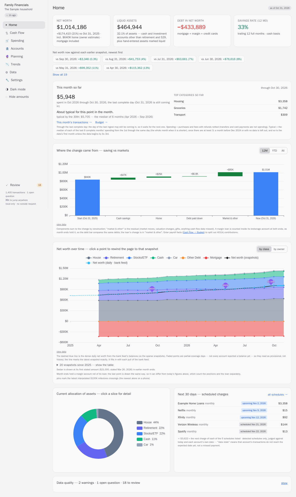
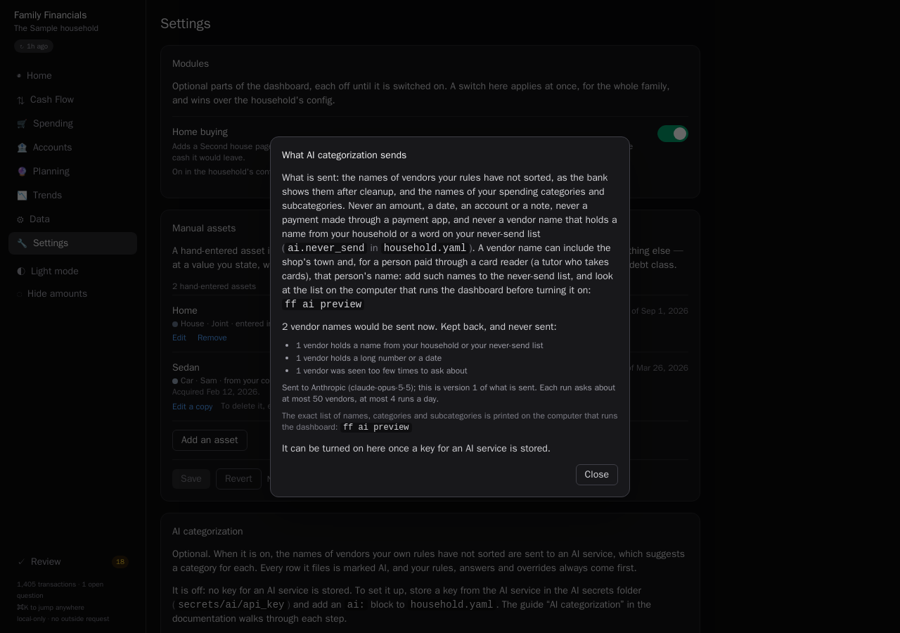
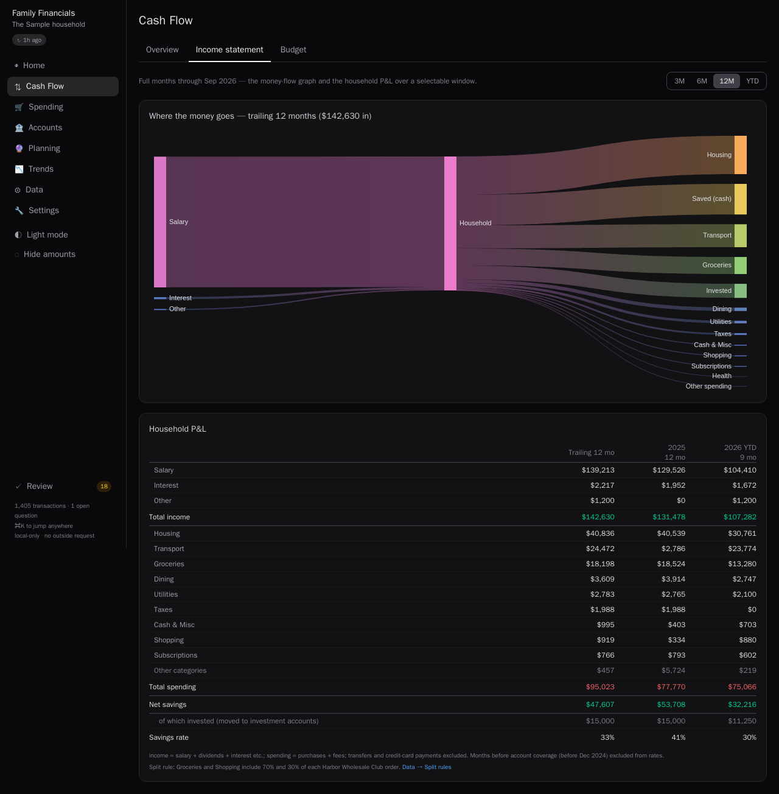
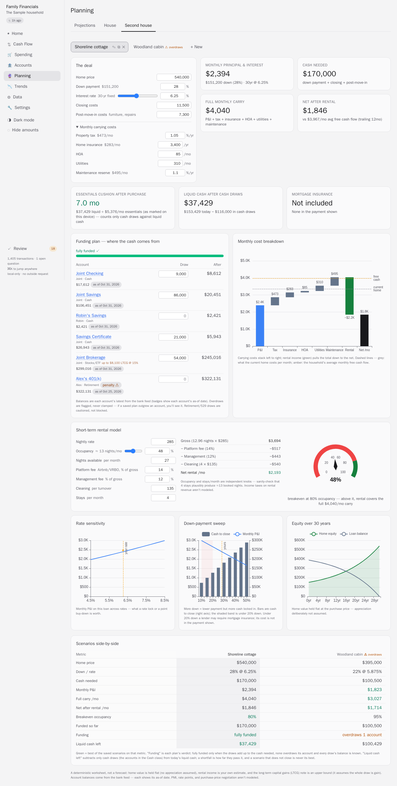
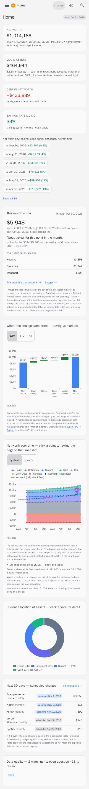

# Family Financials

**A CFO for your household, on your own computer.** Family Financials reads your bank, card, brokerage and loan
statements (or a daily bank feed) into one place and gives the family the reports a company's finance team would
keep: cash flow and an income statement, budgets against what you actually spend, recurring bills and the next 30
days, net worth and what moved it, investments against a target mix, the mortgage, and the what-ifs of a big
decision. It runs at home, in Docker, behind a passcode. Your financial data stays on your machine.



**Try it in your browser first:** the [live demo](https://good-work-dojo.github.io/Family-Financials/) is the real
dashboard over an invented household. It runs in the browser alone: nothing you do there leaves the page, what you
change stays in your browser, and clearing the site's data puts the demo back as it was.

- [What it does, and what it does not](#what-it-does-and-what-it-does-not)
- [Requirements](#requirements)
- [Quick start: the demo household](#quick-start-the-demo-household)
- [Your own household](#your-own-household)
- [Where your data comes from](#where-your-data-comes-from): statement files, and
  [the bank feed (SimpleFIN)](#the-bank-feed-simplefin)
- [How data flows, and what never leaves your machine](#how-data-flows-and-what-never-leaves-your-machine)
- [AI categorization (optional)](#ai-categorization-optional)
- [The dashboard](#the-dashboard) and [tuning the rules](#tuning-the-rules)
- [Honest limits](#honest-limits)
- [Security, and where the dashboard listens](#security-and-where-the-dashboard-listens)
- [Backup, restore and upgrade](#backup-restore-and-upgrade)
- [Leaving](#leaving)
- [Contributing](#contributing), [licence and trademark](#licence-and-trademark)

## What it does, and what it does not

**It does:**

- Read every account's history from the files your bank lets you download (CSV, OFX or QFX; the banks it knows are in
  [docs/importing-banks.md](docs/importing-banks.md), and any other CSV layout is described once, in a short file of
  your own), and optionally from a [SimpleFIN Bridge](https://beta-bridge.simplefin.org) connection, which fetches
  transactions and balances every day.
- File each purchase by your rules (a starter set covers common national merchants), learn from the answers the family
  gives in the Review inbox, pair transfers between your own accounts so they never count as spending, and split a
  mixed-basket store's purchases across categories.
- Check itself on every rebuild: each account's rows add up to its files, a split purchase counts once, and anything
  ambiguous becomes a question for the family instead of a guess.
- Show the whole household on one dashboard, on a computer or a phone, with a privacy mode that hides every amount on
  screen and a CSV of every table.

**It does not:**

- Move money, pay bills, or connect to a bank by itself: the bank feed is a SimpleFIN Bridge account you set up and
  pay for, and the program only reads it.
- Do your taxes, give investment advice or guess: a figure it has no data for shows as "—", never as zero.
- Send your data anywhere. The dashboard and the rebuild make no outside calls; the only networked steps are the bank
  feed's fetch and, if you turn it on, AI categorization, which sends vendor names only.
- Run as a hosted service. There is no account to create, no cloud and no analytics; you run it, for your household.

## Requirements

- **A computer that runs Docker and stays on**, so the scheduled refresh runs:
  - **Supported: 64-bit Linux** (amd64 or arm64, such as a small home server, a NAS or a single-board computer
    running a 64-bit system). This is where Family Financials is developed and tested.
  - **Should work, best effort: macOS with Docker Desktop, and Windows with Docker Desktop on WSL2**, with the
    install folder inside WSL's own Linux files rather than on a Windows drive (`ff` refuses `/mnt/c` and the like).
    These are not tested; if something does not work, please open an issue and say which platform you are on.
- **Docker Engine (or Docker Desktop) with the Compose plugin, v2.20 or newer**, usable by your own user (not root).
  `ff` checks both.
- **Memory:** about 60 MiB for the four services at rest; a rebuild of the data briefly needs about 40 MiB more
  (measured on the demo household: about two years and 1,400 transactions).
- **Disk:** about 400 MB for the two images, plus your statements, the feed's history and the database (about 2 MB
  for the demo household's two years).

Also untested: rootless Docker and SELinux in enforcing mode. `ff` names each of these when it sees it and changes
nothing for it.

## Quick start: the demo household

In an empty directory of its own (not your home directory itself), fetch `ff`, the one command, then let it make the
invented demo household and start the dashboard:

```sh
mkdir ~/ff-demo && cd ~/ff-demo
curl -fsSL -o ff https://raw.githubusercontent.com/Good-Work-Dojo/Family-Financials/v1.0.1/ff && chmod 755 ff
./ff demo        # generates the demo household and prints its passcode once
./ff up          # starts the dashboard and prints the address to open
```

Open the address `./ff up` prints (`http://127.0.0.1:8080` unless you changed it): it takes you to the sign-in page,
`/login`, where you sign in with the passcode `./ff demo` printed. `./ff demo` and `./ff up` download the two images from the GitHub Container Registry the first
time. `./ff down` stops the dashboard and keeps every file. The two warnings its ingest prints are part of the demo: an
account the bank feed stopped reporting, and a bank feed account no account of the household maps, as the Data page
shows them.

If port 8080 is taken, `./ff up` says so: set `FF_PORT` to a free port in the `.env` file `./ff demo` wrote, then run
`./ff up` again. Lost the passcode? `./ff passcode add demo` sets a new one.

### Building the images yourself

Instead of downloading the images, you can build them from the source. Building needs the network (for the base
images and the dashboard's packages) and a few minutes:

```sh
git clone https://github.com/Good-Work-Dojo/Family-Financials.git
cd Family-Financials
./ff build                         # builds both images under the names ff runs
mkdir ~/ff-demo && cp ff ~/ff-demo/ && cd ~/ff-demo
./ff demo
./ff up
```

`./ff build` tags the images with the names and the version `ff` runs by default
(`ghcr.io/good-work-dojo/family-financials-etl:1.0.1` and `…-web:1.0.1`), so the install uses them and downloads
nothing. A copy of the source unpacked from an archive works the same way. To upgrade a locally built install, see
[Backup, restore and upgrade](#backup-restore-and-upgrade).

## Your own household

Use a **new, empty directory** for your household (not the demo's: `./ff init` keeps whatever household it finds),
with `ff` in it, as above. Then:

```sh
./ff init        # asks who you are, where the dashboard listens, the bank feed or the statement files, a passcode
./ff up
```

`./ff init` asks, in order: the household's name, the adults and the children, the name for what you hold together
("Joint"), your time zone, whether to show the home-buying pages, whether the dashboard serves only this computer or
your home network and on which port, a SimpleFIN setup token (now or later), which account each statement file
already in `imports/` belongs to, and a passcode. It writes `config/household.yaml`, `config/accounts.yaml`, the
starter rule files, `.env` and `compose.yaml`, then checks the config. Every step is kept as soon as it is answered,
so a run stopped part way finishes where it stopped. `./ff init` makes `imports/`; put your statement files there
before you answer its question about them, and it sets up their accounts too. `./ff up` then builds the dashboard's
data about a minute after it starts.

**Accounts with no file and no feed yet.** With neither statement files nor a bank feed, `./ff init` leaves
`config/accounts.yaml` with no account, for you to declare them by hand. For a joint checking account and a credit
card of an adult named Alex (each `owner` must be a name your `household.yaml` gives: an adult, the joint label or a
child):

```yaml
version: 1
accounts:
  checking:
    name: Everyday Checking
    institution: Example Bank
    owner: Joint
    kind: checking
  card:
    name: Rewards Card
    institution: Example Card Co
    owner: Alex
    kind: credit-card
```

Then `./ff validate` prints `config OK`, counting the two accounts. `./ff up` works meanwhile: the dashboard says what
is missing. Once their statements arrive, give each account the format and file names that read them (`parser:` and
`glob:`, [Statement files](#statement-files)), then **Rebuild from files** on the Data page or `./ff refresh`; or
connect the bank feed with
`./ff init --feed`: it asks which of these accounts each feed account is, adds the rest as new accounts and leaves
every other line as it is.

**Without questions:** copy the example answers file
[examples/answers.yaml](examples/answers.yaml) **outside** the install directory, make it yours alone, edit it, and
give it to `./ff init`:

```sh
curl -fsSL -o ~/ff-answers.yaml \
  https://raw.githubusercontent.com/Good-Work-Dojo/Family-Financials/v1.0.1/examples/answers.yaml
chmod 600 ~/ff-answers.yaml          # in a copy of the source: cp examples/answers.yaml ~/ff-answers.yaml instead
# edit ~/ff-answers.yaml: your names, time zone and a passcode of your own
./ff init --answers ~/ff-answers.yaml
rm ~/ff-answers.yaml
```

The answers file may hold your passcode and the bank feed's setup token, so `./ff init` refuses one that others can
read or that sits inside the install (where a backup would carry it); delete it once the setup has run. Without a
`feed:` block, `./ff init` runs with no network at all.

**Checking it:** `./ff validate` prints `config OK` or every problem at once, one line each, as
`file: key: what is wrong — how to fix it`. `./ff doctor` checks the whole install (the folders and their owners, the
settings, the config, the passcode, the feed's freshness, free space, the port) and says how to fix each problem.
The config lives in `config/` as plain YAML: every key, its type and its default is in
[docs/configuration.md](docs/configuration.md), and `./ff validate` checks it after every edit.

**When a command stops on an unexpected error**, it prints one line naming `data/last-error.txt`, which holds the
details; `FF_DEBUG=1 ./ff <command>` prints them instead. Read the file before you attach it to a bug report: it can
name your files and accounts.

The install directory holds everything, each folder readable by you alone:

| Folder | Holds |
|---|---|
| `config/` | the household's YAML: `household.yaml`, `accounts.yaml`, the rule files, your own file layouts in `presets/` |
| `imports/` | the statement files you download from your banks (never changed by the program) |
| `store/` | the bank feed's daily snapshots (history no feed gives again) and the AI step's answers |
| `secrets/` | the passcodes' hashes, the bank feed's access, the AI key and the alert credentials, one folder each |
| `state/` | the family's answers, preferences, scenarios and hand-entered assets; the sign-in sessions; the refresh's own files |
| `data/` | the database and the dashboard's data, rebuilt from the above on every refresh |
| `backups/` | what `./ff backup` writes |

`./ff` alone lists every command. How the install works in detail: [docs/design/platform.md](docs/design/platform.md).

## Where your data comes from

### Statement files

Download each account's activity from your bank's website, put the file in `imports/` and say in
`config/accounts.yaml` which format reads it and which file names are that account's (a pattern such as
`"checking-*.csv"`, so next month's download is picked up by itself). `./ff import detect imports/FILE` names the
formats that read a file; for a CSV layout no format reads, `./ff import map imports/FILE --id NAME` asks about its
columns and writes a layout of your own. Overlapping downloads are fine: a row two files share is stored once.
[docs/importing.md](docs/importing.md) walks through it, including years of history in more than one format, and
[docs/importing-banks.md](docs/importing-banks.md) is the table of banks this release reads.

After you add files, rebuild: on the Data page, **Rebuild from files** (**Refresh now** when a bank feed is set up, which
fetches first), or `./ff refresh`. The scheduled refresh also reads whatever is new in `imports/`.

### The bank feed (SimpleFIN)

A [SimpleFIN Bridge](https://beta-bridge.simplefin.org) account connects to your banks and lets one program read
your transactions and balances, about once a day. Family Financials fetches from it at the hours `household.yaml`'s
`refresh` names (by default 1, 9 and 17 o'clock on the household's clock, at a minute past the hour `./ff init`
picks) and on **Refresh now**, well within the
Bridge's limit of 24 requests a day. Each fetch is kept as a dated snapshot in `store/simplefin/`, so the balance
history grows from the day you connect; the first fetch reaches back 90 days.

To set it up:

1. Create a SimpleFIN Bridge account, connect your banks there and create a **setup token** (a single-use code).
2. Give the token to `./ff init`: it claims the connection once (storing the access in `secrets/feed/`, readable by
   you alone), fetches the last 90 days and asks which of your accounts each feed account is. In an install that is
   already set up, `./ff init --feed` does this step alone: for each feed account `accounts.yaml` does not name, it
   asks whether it is one of your accounts (which then gets the feed's id), a new one, or none, and keeps every other
   line of `accounts.yaml` and all of `household.yaml` as they are (the file as it was stays as
   `accounts.yaml.previous`).
3. That is all: every refresh fetches, then rebuilds. An account that has statement files from before the feed gets
   a `simplefin_cutover` date (`./ff init` sets it): the files own the days before it, the feed the days from it.

**When a bank needs you to sign in again.** Banks end such connections now and then. The refresh then says which
connection needs it (an alert, if you set alerts up, and a warning on the Data page), and that account's balance
stops moving. Sign in to SimpleFIN Bridge and reconnect that bank there; the next refresh picks it up. If reconnecting
means deleting the bank in SimpleFIN and adding it again, the feed gives the account a **new id**: the Data page then
shows an "Unmapped bank account". After that refresh, `./ff init --feed` offers each new id to the account whose old
id the feed no longer lists, and moves the old id to its history when you pick it. By hand instead:
`./ff simplefin list-accounts` lists the feed's accounts with their ids, each
beside the account that maps it or marked unmapped: put the new id in the account's `simplefin_id` in
`config/accounts.yaml`, move the old one to its `simplefin_id_history` list (so the snapshots under the old id keep
feeding the history), run `./ff validate`, then **Refresh now**. Delete the bank's old connection in SimpleFIN
before adding it again: while the feed lists both, `./ff init --feed` cannot tell the new id belongs to an existing
account (answer it by hand rather than taking "a new account", which would count the account twice). The days both
connections cover can show some transactions twice, because the bank gives them new ids (see the roadmap).

Mapping options, credit limits, loans and brokerages are in [docs/configuration.md](docs/configuration.md)
(`accounts.yaml`). Without a feed, everything works from statement files alone.

### Hand-entered values

A value no bank reports (the home, a car, a private holding) is entered in Settings → Manual assets, or listed under
`manual_entries` in `accounts.yaml`; net worth counts it from its date.

### Alerts (optional)

A refresh that fails, a bank connection that needs signing in again, and an AI key that stops working can send you a
message through a Telegram bot or a webhook of your own: the credentials go in files in `secrets/alerts/`
([docs/design/platform.md](docs/design/platform.md), "Alerts"), each readable by you alone (an alert is not sent
through a file others may read). In the install directory, for a Telegram bot:

```sh
umask 077
printf '%s' 'YOUR-BOT-TOKEN' > secrets/alerts/telegram_token
printf '%s' 'YOUR-CHAT-ID' > secrets/alerts/telegram_chat_id
docker compose exec refresher /opt/ff/deploy/refresh.sh test-alert   # sends a test message (the dashboard running)
```

With none set up, nothing is sent.

## How data flows, and what never leaves your machine

```
your bank's downloads ──► imports/ ─┐
SimpleFIN Bridge ─(fetch)─► store/ ─┼─► rebuild (offline) ─► data/: finance.db + the dashboard's JSON ─► dashboard
your config/ + the family's answers ┘                                                             (behind a passcode)
```

- **The rebuild is offline and repeatable**: it reads `config/`, `imports/`, `store/` and the family's answers and
  writes `data/`, the same output for the same input every time. It makes no network call.
- **The dashboard is a page your own computer serves**; it loads nothing from elsewhere (its Content Security Policy
  forbids it) and keeps no analytics. Its data is the rebuild's JSON: each `data/exports/X.json` is served at `/X.json`
  (`data/exports/manifest.json` at `/manifest.json`), behind the sign-in: a request without a session gets 401 (a browser is sent to `/login`).
- **Two steps use the network**, each separate from the rebuild: the bank feed's fetch (to SimpleFIN Bridge, over
  HTTPS, only when a feed is set up) and AI categorization (only when the family turns it on; below).
- **The part a browser reaches holds no credential.** The four services are split by what they may touch: the web
  server and the family store (what a browser talks to) never see the bank feed's access, the AI key or your
  statements, and can only *ask* for a refresh; the two background workers that fetch and rebuild are never reached
  from a browser. [docs/architecture.md](docs/architecture.md) draws the whole picture.

## AI categorization (optional)

A purchase none of your rules or answers places waits under Uncategorized for the family to answer. AI
categorization is an optional step that asks an AI service to suggest a category for the vendors of those purchases,
so fewer of them wait. It is **off** until a key for an AI service is stored on the computer that runs the dashboard
*and* someone in the family turns it on in Settings, after seeing the counts of what would be sent there and the list
itself with `./ff ai preview`. With it off nothing is sent.



**What is sent:** the vendor names it asks about (as the dashboard shows them, in lower case, and by default only
from credit-card purchases), your spending categories and subcategories by name, a fixed instruction and the version
of what is sent. **What is never sent:** an amount, a date, an account, a balance, a note or a tag, a row's
description as the bank printed it, a vendor or category name that holds a name from your household (or a word you
list in `ai.never_send`), a name holding a number of three or more digits, a date, an e-mail or web address, a payment
made through a payment app, a transfer between your own accounts, and a split purchase.

A suggestion files a vendor only when the service is sure enough, every such row carries an **AI** mark, and your own
rules and answers always come first. Settings' AI categorization card shows the counts, the service and the model;
`./ff ai preview` prints the exact list, with no key and no network. Each service's own retention and training terms,
how to use a model of your own, and how to turn it off and forget its answers:
[docs/ai-categorization.md](docs/ai-categorization.md).

## The dashboard

Seven sections in the sidebar, then Settings. Until the first data arrives, a set-up page stands in for every page
but Data and Settings and says what is missing.

| Section | Tabs | What it answers |
|---|---|---|
| **Home** | — | net worth and what moved it, this month's spending so far against the usual pace by the same day, allocation, the next 30 days of bills, a data-quality summary |
| **Cash Flow** | Overview · Income statement · Budget | money in and out by month; the income statement and its flow chart; a budget grid of the last full months against each category's typical month |
| **Spending** | Explore · Transactions · Recurring · Reports | charts by category, vendor and day; the full register (bulk categorize, tags, saved views, CSV); recurring charges and their schedules; a report builder |
| **Accounts** | Balances · Investments · Liabilities, and a page per account | balances and the balance sheet, holdings, the target mix, debts; per account its balance history and transactions |
| **Planning** | Projections · House · Second house | runway, emergency fund and forecast; the mortgage (once an account is marked as the mortgage); a second-home worksheet (switched on in Settings) |
| **Trends** | — | savings rate, burn, allocation and liquidity over the long run |
| **Data** | — | freshness and **Refresh now**, the quality report, open questions, the learned and split rules in force, privacy mode |

**Review**, at the foot of the sidebar, is the inbox of transactions that still need a category.







- **⌘K** (the search button on a phone) jumps to any page, or to a category's or a vendor's last six months.
- **Privacy mode** (`Alt+Shift+P`, the "Hide amounts" button, or the eye in the phone's top bar) hides every dollar
  amount on this device while names, dates and percentages stay. CSV exports are never masked, and every CSV button
  says so.
- **Recurring charges** become schedules once they repeat steadily; each shows "paid", "due", "upcoming" or "missed",
  and says "data stale" instead when the data does not reach far enough to tell.
- **After an upgrade**, an open tab says "The dashboard was updated — reload this page to switch to the new
  version".

## Tuning the rules

Rules live in `config/*.yaml` and take effect at the next rebuild; run `./ff validate` after an edit, since a rebuild
refuses a config with problems. Answers given in the app show at once and stick at the next rebuild.

- **Review answers.** The Review inbox asks for a category per row: answer **this transaction**, or **always for
  this vendor** (one answer files the vendor for good). On Spending → Transactions, select up to 100 rows to
  categorize or tag them at once.
- **Learned rules.** Once three of a vendor's five newest answers agree, or after one "always for this vendor"
  answer, the vendor is filed that way automatically, marked `learned`. Mixed-basket stores (a warehouse club, a
  department store, an online marketplace), payment apps and bare descriptors such as "check" or "withdrawal" are kept
  out of learning, since one name there covers many different purchases. To undo a learned rule, give a newer "always
  for this vendor" answer, or set `learn: false` on the vendor.
- **Splits.** A mixed-basket vendor's purchases can be split by rule (`split:` legs in `vendor_rules.yaml`): each
  purchase shows once, and its parts carry the money into each category.
- **Renames.** `renames:` in `vendor_rules.yaml` or `category_rules.yaml` renames a vendor or a category everywhere;
  nothing stored is rewritten.
- **Facts only the family knows** (a check that repaid a family loan) go in `config/overrides.yaml`, applied last. An
  override that stops matching raises a warning instead of disappearing.
- **Try a rule before it lands**: put candidate keyword rules in a file inside the install and preview them; nothing
  is written.

```sh
./ff rules preview --file candidates.yaml   # hits, and old -> new category counts
./ff rules overlaps                         # rules that never win
./ff rules starter-diff                     # starter entries your rule files lack
```

Every rule shape: [docs/configuration.md](docs/configuration.md). How each part works:
[docs/design/](docs/design/README.md).

## Honest limits

**Transfers.** A transfer between your own accounts, or a card payment, is kept out of spending and income when both
sides are in the data and pair. A payment received on a credit card is always kept out. Any other side that finds no
partner stays an ordinary row: flagged for review when a `kinds:` transfer rule recognised it or it is uncategorized
above the review thresholds, and counted without a flag when a category rule, the bank's label or a learned rule
filed it. So an account you have not added (a brokerage you transfer savings to) can make a transfer read as
spending until you add it or write a transfer rule (`transfer_rules.yaml`).

**What a new household does not get yet:**

- The automatic pairing never pairs brokerage or loan rows, and it pairs a transfer only when nothing else explains
  either side: most own-account transfers need a transfer rule naming the accounts.
- A broad `kinds:` transfer rule can type a refund as a payment. A rule's `from_text:` hint that matches no account
  is silent.
- The bank feed reader files a few brokerage events under its own subcategories (dividends, margin interest,
  reimbursements), recognising brokerage cash events by their wording; wording it does not know may land
  uncategorized.
- A purchase in flight on the day two sources meet (a statement file and the feed, or two file formats) can be
  counted by both or neither; a warning points at the days to check.
- Figures the dashboard labels but does not model yet are listed in [docs/ROADMAP.md](docs/ROADMAP.md).

**The sign-in over plain HTTP.** On your home network without a domain, the passcode and the session cookie cross
the network unencrypted (below).

## Security, and where the dashboard listens

The dashboard is behind a passcode: each one is stored only as a scrypt hash, sessions are kept on the server, wrong
guesses are throttled per address (and a household's own browsers are never locked out), and a request from another
site is refused. Every page carries a strict Content Security Policy. Where it listens is set in `.env` (each setting
is described in the file); pick one of four:

| Where | Set in `.env` | Notes |
|---|---|---|
| **This computer only** (the default) | `FF_BIND=127.0.0.1` | nothing else on the network can reach it |
| **Your home network**, plain HTTP | `FF_BIND=` this computer's address on your network, such as `192.0.2.10` | the passcode and the session cookie cross the network in clear; `./ff doctor` warns of it. `./ff up` refuses plain HTTP on an address the internet can reach |
| **A domain of your own**, automatic HTTPS | `SITE_ADDRESS=dash.example.net`, `FF_BIND=0.0.0.0`, `FF_PORT=80`, `FF_PORT_TLS=443` | the name must point at this computer and ports 80 and 443 reach it; the web server gets and renews the certificate |
| **Behind a tunnel or a proxy** that holds the certificate | `SITE_ADDRESS=:8080`, `FF_HOSTNAMES=` the public name, `TRUSTED_PROXIES=` the proxy's address range | the proxy's `X-Forwarded-Proto: https` makes the cookies secure |

For a tunnel or proxy **on the same computer** (it connects to `127.0.0.1:8080`), the address the web server sees is
the gateway of the Docker network it listens on, not the proxy's own: find it with
`docker network inspect <name>_front --format '{{range .IPAM.Config}}{{.Gateway}}{{end}}'`, where `<name>` is the
install directory's name as `docker network ls` shows it, and set `TRUSTED_PROXIES` to that address followed by `/32`.

Set these in `.env`, never in your shell: `./ff up` refuses a setting given in the environment, and names any line of
`.env` written in another form (no quotes, no spaces at the end). After a change, `./ff up` again. The full model
(what a stranger can and cannot do, the capability split, the known limits): [docs/security.md](docs/security.md).
Report a security problem privately: [SECURITY.md](SECURITY.md).

**Signing in from a script.** A script signs in as the sign-in page does: it posts the passcode to `/auth/login`
(form-encoded as `passcode=…`, or as JSON `{"passcode": "…"}`) with an `Origin` header equal to the dashboard's own
address, its scheme, name and port as the script reaches it (`Origin: http://127.0.0.1:8080` by default), and keeps the
session cookie the answer sets; a post without that header, or with another address in it, is refused. For example,
with the passcode alone in a file of your own (no line ending):

```sh
curl -sS -c cookies.txt -H 'Origin: http://127.0.0.1:8080' --data-urlencode passcode@passcode.txt \
  http://127.0.0.1:8080/auth/login
curl -sS -b cookies.txt http://127.0.0.1:8080/manifest.json
```

## Backup, restore and upgrade

**Backup.** `./ff backup` writes `backups/ff-<date and time>.tar.gz` (readable by you alone): the config, the family's
answers and documents, the learned rules and the bank feed's snapshots. The database and the dashboard's data are
left out because a rebuild makes them again; the sign-in sessions are left out (everyone signs in again).
`./ff backup --include-secrets` adds `secrets/` (the passcodes' hashes, the feed's access, the AI key): keep that
archive as safe as the install itself. Copy backups off the computer; `.env` is not in the archive, so keep a copy of
it too.

**Restore**, on the same computer or a new one: in a new install directory holding `ff` and your old `.env` (with
`FF_UID` and `FF_GID` set to the output of `id -u` and `id -g` on this computer), copy the archive in and run

```sh
./ff restore ff-20261101T120000Z.tar.gz   # the archive's name; it must be inside the install directory
./ff passcode add NAME                    # only if the archive holds no secrets
./ff up
```

`./ff restore` checks the whole archive before writing anything and refuses to overwrite a config that is there
(`--force` replaces files of the same name). An archive made with `--include-secrets` brings the bank feed's access
back with it. Without the secrets, connect the bank feed again with a new setup token: `./ff init --feed` keeps the
config the restore put back and adds only what is new. Not `./ff init --force`, which asks for the household again
and replaces that config (keeping it only as `household.yaml.previous` and `accounts.yaml.previous`).

**Upgrade, with the published images.** `./ff upgrade --to 1.1.0` (the new version, as the release notes name it)
backs up first, keeps your settings as `.env.previous`, downloads the new images, checks your config with them,
restarts, rebuilds the data and runs `./ff doctor`. It also brings `compose.yaml` to the new release's, keeping the
old one as `compose.yaml.previous`; if you changed yours by hand, it is kept and the new release's is written beside
it as `compose.yaml.new` for you to compare. If it stops before restarting, nothing changed. If it stops after, it
says how to go back: `cp .env.previous .env` (and `cp compose.yaml.previous compose.yaml` when it replaced that), then
`./ff up`, then `./ff refresh` to rebuild the data for the release before. Copy the new release's `ff` over your
install's too.

**Pinning the images by digest.** A tag can be moved; a digest cannot. To run exactly the images you checked, name
each by its digest in `.env`, as `FF_IMAGE_ETL=ghcr.io/good-work-dojo/family-financials-etl:1.0.1@sha256:…` and the
same for `FF_IMAGE_WEB` (`docker buildx imagetools inspect` on an image prints its digest); `./ff upgrade --to`
replaces the pin with the new release's tag.

**Upgrade, with images you built.** `./ff upgrade` downloads images, which a locally built install does not use.
Instead, in the source, check out the new release and build it, then in the install point `.env` at the new images:

```sh
cd ~/Family-Financials && git fetch --tags && git checkout v1.1.0 && ./ff build
cd ~/family-financials                       # your install
cp ~/Family-Financials/ff . && ./ff backup
# in .env: FF_IMAGE_ETL=ghcr.io/good-work-dojo/family-financials-etl:1.1.0
#          FF_IMAGE_WEB=ghcr.io/good-work-dojo/family-financials-web:1.1.0
./ff up && ./ff refresh && ./ff doctor
```

`./ff up` with the new images brings `compose.yaml` to the new release's as `./ff upgrade` does. To go back, set the
two lines to the old version (and `cp compose.yaml.previous compose.yaml` if it was replaced), `./ff up` again, then
`./ff refresh` (after `./ff restore <the backup> --force` if the new release changed your config).

## Leaving

Everything is plain files in the install directory, in open formats: your statements as you downloaded them
(`imports/`), your config as YAML (`config/`), the bank feed's snapshots as JSON (`store/simplefin/`), the family's
answers and documents as JSON (`state/family/`), and every transaction, category and balance in an SQLite database
(`data/finance.db`) and JSON files (`data/exports/`). Any table in the dashboard downloads as CSV. To stop, run
`./ff down`, keep what you want, delete the directory, and remove the two images (`docker image rm`).

## Contributing

Contributions are welcome. The most useful one is often a **bank's CSV layout**: a preset is a short YAML file, no
code, and [docs/importing.md](docs/importing.md) and [CONTRIBUTING.md](CONTRIBUTING.md) say how to add one. If you
cannot write it yourself, open a "Bank format request" issue with the file's header row and a few invented rows,
never a real statement. [CONTRIBUTING.md](CONTRIBUTING.md) covers the rest (the gate, the words and the contributor
agreement); [AGENTS.md](AGENTS.md) is the map of the code, [docs/architecture.md](docs/architecture.md) the overview,
and [docs/ROADMAP.md](docs/ROADMAP.md) what is planned. Everyone taking part follows the
[Code of Conduct](CODE_OF_CONDUCT.md).

## Licence and trademark

Family Financials is free software under the GNU Affero General Public License, version 3 only
([LICENSE](LICENSE)), with the additional terms in [NOTICE](NOTICE): keep the attribution line on the About screen
and the sign-in page, and mark a changed version as changed. It comes with no warranty. If you run a changed version
for others over a network, the licence asks you to offer them its source. The name and the logo are not licensed:
a changed version needs a name of its own ([TRADEMARKS.md](TRADEMARKS.md)). Contributions are made under the
[contributor agreement](CLA.md). The third-party software it includes and their licences:
[THIRD_PARTY_NOTICES.md](THIRD_PARTY_NOTICES.md).
